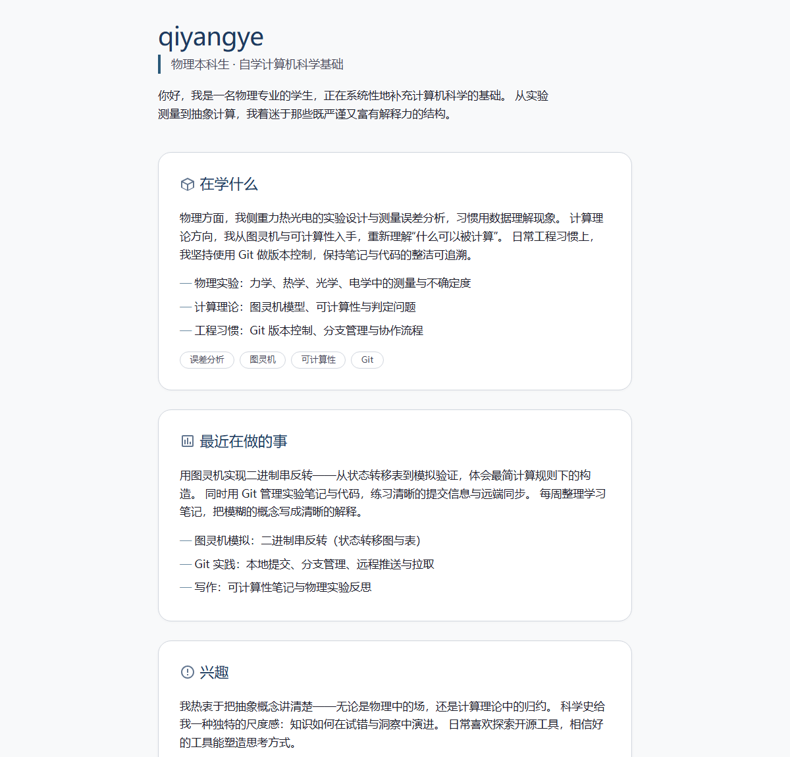

# qiyangye.github.io · 个人主页

我的个人主页源码，发布地址：**<https://qiyangye.github.io/>**



## 这是什么

一个单页个人主页，用来介绍我自己：物理专业在读，正在自学计算机科学基础（计算理论、版本控制、科学写作）。

页面包含四个部分：

- **开场**：一句话说明身份与关注方向
- **在学什么**：物理实验与误差分析、图灵机与可计算性、Git 工程习惯
- **最近在做的事**：用图灵机实现二进制串反转、Git 版本管理实践、学习笔记
- **兴趣**：把抽象概念讲清楚、科学史、开源工具

## 文件

| 文件 | 说明 |
|---|---|
| `index.html` | 整站唯一文件，样式内嵌，无外部依赖 |

## 技术说明

- **单文件**：HTML + 内嵌 CSS，不加载任何 CDN、字体或图片，断网也能正常显示
- **响应式**：720px 阅读宽度，520px 以下切换为手机版式
- **深色模式**：跟随系统 `prefers-color-scheme` 自动切换，颜色全部走 CSS 变量
- **可访问性**：语义化标签、`aria-labelledby`、焦点可见样式、装饰性 SVG 标记 `aria-hidden`
- **图标**：全部为内联 SVG 与 data-URI favicon，无外部请求

## 本地预览

直接双击 `index.html`，或在目录里执行：

```bash
python -m http.server 8000
```

然后访问 <http://localhost:8000>。

## 隐私

页面与仓库中**不含**真实姓名、学校、学号、邮箱、电话、住址或照片。昵称与 GitHub 主页链接是唯一的身份信息。
